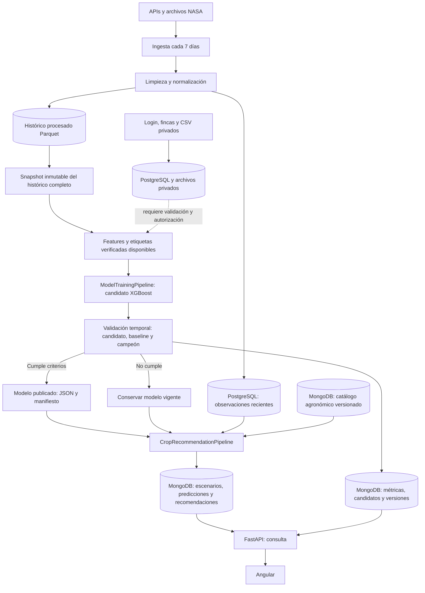

> Frontend vigente: Angular en `frontend/`; Next.js fue retirado en la migración.
> Contratos y estado de integración: [frontend-migration.md](frontend-migration.md).

# Arquitectura de Field Shift

El flujo operativo se ejecuta fuera de las peticiones HTTP. La ingesta, el
reentrenamiento y las recomendaciones son tres jobs independientes con estado
persistente. Angular consulta resultados ya calculados mediante FastAPI.

## Responsabilidades del código

| Ruta | Responsabilidad |
| --- | --- |
| `pipelines/ingestion/sources/nasa/` | Clientes HTTP y descubrimiento por fuente |
| `pipelines/ingestion/flows/{power,weekly}.py` | Ingesta incremental y coordinación de fuentes; no ejecutan modelos |
| `pipelines/ingestion/storage/power.py` | Histórico Parquet por punto y año |
| `pipelines/processing/` | Limpieza, unidades, calidad y procesamiento geoespacial |
| `pipelines/training/snapshots.py` | Copia identificable e inmutable del histórico completo |
| `pipelines/training/pipeline.py` | `ModelTrainingPipeline`: preparación, candidato, evaluación y promoción |
| `pipelines/training/job.py` | Evaluación de tareas por región, modelo y horizonte |
| `ml/training/contracts.py` | Puertos del constructor de datasets, trainer y registro |
| `ml/training/xgboost.py` | Adapter real de entrenamiento XGBoost y carga de Boosters JSON |
| `ml/training/artifacts.py` | Artefactos versionados y verificación de integridad |
| `ml/evaluation/promotion.py` | Separación temporal con purga, MAE y criterios de promoción |
| `ml/inference/contracts.py` | Interfaces de predicción y recomendaciones |
| `pipelines/recommendations/` | Inferencia con modelos publicados y persistencia de resultados |
| `pipelines/scheduling/runner.py` | Bloqueos y reintentos independientes de los jobs ML |
| `apps/api/app/repositories/mongo.py` | Resultados, catálogo, métricas y registro ML en MongoDB |
| `apps/api/app/repositories/model_registry.py` | Registro de compatibilidad PostgreSQL para desarrollo local |
| `apps/api/app/repositories/runtime.py` | Selección explícita de la persistencia de resultados |
| `apps/api/app/routers/farmers.py` | Autenticación y datos privados de fincas |
| `apps/api/app/main.py` | Lectura de resultados almacenados y estado de automatización |
| `scripts/runtime.py` | Composition root: conecta adapters, políticas y jobs |
| `scripts/worker.py` | CLI y scheduler; permite ejecutar los jobs juntos o separados |
| `packages/contracts/` | DTOs HTTP, datasets, políticas, versiones y contratos compartidos |

`apps/api/app/services/analysis.py` y `scripts/weekly_ingestion.py` conservan
imports compatibles; sus implementaciones se trasladaron a `pipelines/`.
Los módulos de entrenamiento y evaluación no dependen de FastAPI. Las cuentas,
fincas y observaciones locales conservan la integración PostgreSQL existente.

## Frecuencias independientes

- `nasa-weekly`: cada 604800 segundos, inicialmente pendiente. Conserva los
  reintentos por fuente y el backoff HTTP existente.
- `model-training`: revisa cada 86400 segundos si existe material nuevo suficiente.
  Una ingesta completada adelanta esta revisión. Revisar no significa publicar.
- `crop-recommendations`: revisa cada 3600 segundos. La ingesta completada y una
  publicación de modelos adelantan el job. El periodo objetivo comienza en el
  día de la ejecución en `America/Bogota`; se generan los horizontes 7/15/30/60.

Los tres calendarios se guardan en `job_schedules`. Cada job usa un advisory lock
propio y registra fallos sin borrar el campeón o los resultados anteriores.
Los jobs ML reintentan después de 1, 2, 4, 8, 16 y hasta 24 horas. La falta de
etiquetas o de adapters es un estado informativo, no un error de conexión.
El siguiente ciclo independiente vuelve a comprobar el histórico aunque una
señal de actualización se perdiera al detener un proceso.

## Límites científicos y estado real

La estructura ejecutable, snapshots, adapter XGBoost, evaluación, registro,
MongoDB y scheduler están implementados. **No hay un modelo agrícola publicado.**
El composition root deja desactivados el constructor de features/etiquetas,
las políticas MAE y los adapters de inferencia hasta definirlos y validarlos.
Un snapshot de POWER no convierte automáticamente sus valores en etiquetas
verificadas de precipitación, suelo o aptitud de cultivo.

El entrenamiento usa todo el histórico disponible hasta el corte y conserva una
copia exacta. La receta debe seleccionar muestras válidas, construir lags sin
información futura y documentar procedencia, unidades, horizonte y baseline.
Si el suelo utiliza predicciones climáticas, necesita predicciones fuera de
muestra durante el entrenamiento; no puede usar clima futuro observado como si
hubiera sido conocido al emitir el pronóstico.

Los CSV privados conservan `format_validated_unverified`; no se mezclan con el
entrenamiento regional ni con datos públicos por el solo hecho de subirlos.
Los archivos satelitales protegidos siguen requiriendo Earthdata; descubrir
un gránulo mediante CMR no equivale a extraer una observación científica.

Consulta [autonomous-training.md](autonomous-training.md) para los contratos,
la validación y las instrucciones de ejecución.
