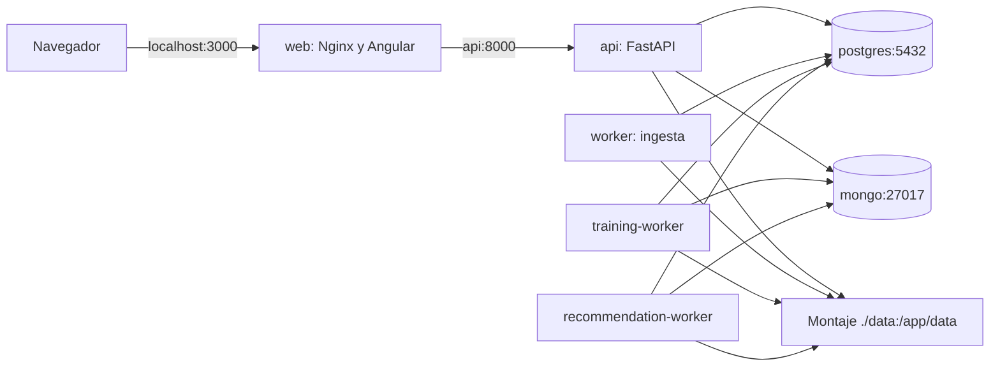

# Vista de despliegue

Esta vista describe las configuraciones ejecutables del repositorio. La instalación
productiva, sus respaldos y objetivos de carga requieren validación del entorno.

## Docker Compose



| Servicio | Función | Persistencia o acceso |
| --- | --- | --- |
| web | Build Angular servido por Nginx y proxy `/backend/` | Puerto host 3000 en loopback |
| api | HTTP y aplicación de migraciones al arrancar | Puerto host 8000 en loopback |
| postgres | Identidad, fincas, observaciones y calendarios | Volumen `agrogeo_postgres_data`; puerto host 5432 en loopback |
| mongo | Registro ML y resultados | Volumen `agrogeo_mongo_data`; sin puerto publicado al host |
| worker | Ingesta periódica | Directorio compartido `/app/data` |
| training-worker | Construcción, entrenamiento y evaluación | Directorio compartido y registro ML |
| recommendation-worker | Inferencia y evaluación de rotación | Snapshots, artefactos y resultados |

API y workers esperan los healthchecks de las bases. Los workers se construyen
con el extra ML y `libgomp1`; la API puede leer metadatos sin cargar XGBoost.
Los artefactos empaquetados están bajo `/app/ml/artifacts`; los datos operativos
usan `/app/data`. Las rutas de overrides deben existir dentro del contenedor.
El proyecto Compose se llama `agrogeo`. Los nombres de bases, usuario y volúmenes
se pueden configurar para conservar instalaciones existentes; cambiar el nombre
del proyecto no migra su almacenamiento. El build Angular genera
`frontend/dist/agrogeo/browser`, que Nginx sirve desde su directorio público.

## Entorno nativo

`scripts.dev_stack` inicia PostgreSQL persistente y opcionalmente MongoDB local,
API y Angular. Usa directorios de `data/local/` y MongoDB en puerto 27018 cuando
se elige `--with-mongo`. Incluye el consumidor de actualizaciones manuales, que
permanece inactivo hasta que se encola una solicitud. `--with-workers` activa
también ingesta y entrenamiento diarios y recomendaciones cada hora, en procesos
independientes con los mismos calendarios y conexiones. No mezclar las bases nativas con las de Compose suponiendo
que comparten estado.

## Requisitos de operación

Configurar secretos propios, HTTPS, cookie Secure, orígenes y proxies de confianza
antes de exponer la aplicación. Las bases y los archivos privados no deben estar
servidos por Nginx. Los respaldos deben cubrir PostgreSQL, el backend de resultados,
CSV privados, snapshots y modelos referenciados con un corte consistente.

No hay un orquestador externo ni una política automática de eliminación de
artefactos referenciados. La operación debe comprobar capacidad, restauración,
retención, dependencias y métricas bajo el volumen de despliegue elegido.

Ver [configuración](../reference/configuration.md),
[guía local](../guides/development.md) y [runbook](../operations/runbook.md).

## Producción en agrogeo.app

`compose.production.yaml` conserva el proyecto Compose `agrogeo` y los volúmenes
existentes. Nginx sirve Angular en `127.0.0.1:8082`, destino del túnel Cloudflare
existente. API y bases de datos permanecen dentro de la red Docker. Las cookies
usan Secure y el origen permitido es `https://agrogeo.app`.

La configuración privada está en `.env.production`, con permisos 0600 y las claves
`POSTGRES_PASSWORD` y `CORS_ORIGINS`. Se conserva el usuario/base PostgreSQL
`fieldshift` y la base MongoDB `fieldshift` de la instalación anterior. No regenerar
credenciales ni eliminar volúmenes al actualizar. Los archivos operativos persisten
en `data/`; el respaldo previo a la migración está en `data/backups/`.

```bash
bash scripts/deploy_production.sh
```

El checkout operativo está en `/home/apogeo/projects/agrogeo`. Los contextos de
build y el montaje `./data` son relativos al archivo Compose, para permitir mover
el checkout sin conservar rutas obsoletas. Las imágenes identifican el commit de
aplicación; el API/worker instala `libexpat1` cuando se habilita `processing`, además
de OpenMP para ML. Herramientas Windows y metadatos locales no entran en el contexto
Docker. Los secretos y respaldos permanecen fuera de Git.

Las imágenes usan la etiqueta del commit de la rama que se publica. Al publicar
otro commit, actualizar las etiquetas en `compose.production.yaml` antes del build.
