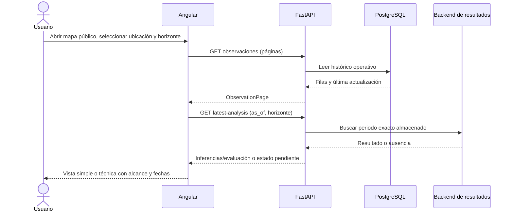
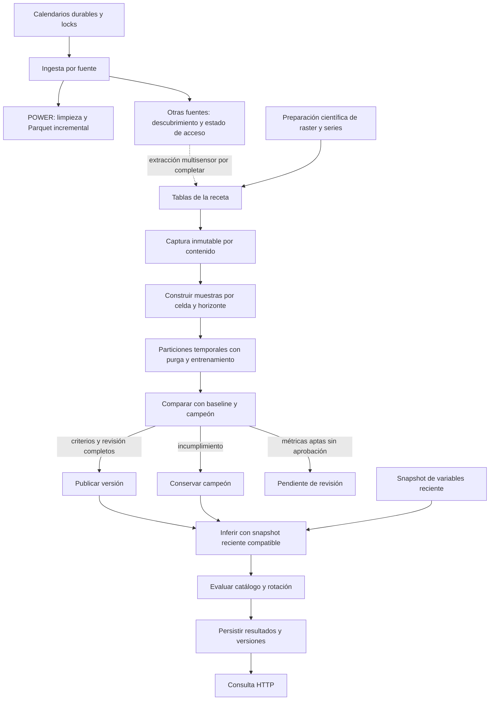

# Flujos de ejecución

Los escenarios distinguen el comportamiento implementado de la integración privada
que aún requiere completarse. Los límites y criterios se centralizan en
[capacidades](../reference/capabilities.md).

## Consulta pública de análisis

El explorador muestra mapa, delimitación opcional y resultados en la misma página.
Es también el destino predeterminado tras autenticarse. Las direcciones de panel
y análisis redirigen a este espacio. Con sesión se pueden consultar hasta veinte
resultados regionales recientes de la ubicación elegida y abrirlos con su fecha,
plazo, estado y trazabilidad originales. Una consulta nueva limpia la selección
temporal; la generación de resultados continúa en los workers.
La consulta no exige cuenta ni ficha de finca. Las ubicaciones de referencia se
filtran por el área seleccionada y los resultados mantienen su ámbito regional;
si no hay coincidencia se informa la ausencia. Otras ubicaciones solo se consultan
mediante selección explícita. Guardar una finca o subir mediciones sí requiere
sesión; la API mantiene autorización por propietario y CSRF.

Los periodos operativos comienzan el día de consulta en `America/Bogota`. El corte
de entradas conserva la fecha real del snapshot. La consulta no descarga NASA,
entrena ni ejecuta modelos. El histórico de la pantalla es el operativo paginado;
el entrenamiento utiliza el histórico procesado elegible en Parquet.

## Registro, finca y mediciones privadas

1. El usuario se registra o inicia sesión. FastAPI verifica credenciales y emite
   una cookie HttpOnly; el navegador restaura la sesión al recargar.
2. El propietario registra ubicación, polígono y ficha. El backend valida geometría
   y campos; editar exige la revisión vigente para evitar sobrescrituras.
3. El propietario puede subir CSV con fechas, variables, valores y unidades. Se
   valida la carga completa, se conserva el original privado y se normalizan filas.
4. Una repetición idéntica no duplica el dataset. Consultar, descargar y eliminar
   requieren autorización por propietario y, en escrituras, CSRF.
5. El contexto de finca reúne ficha, observaciones y versiones hasta el corte;
   informa conflictos y limita su interpretación a la calidad verificada.

Registrar la ficha aporta contexto local para personalización. Su uso completo
con el análisis y las reglas requiere la asociación privada descrita más abajo.
La aceptación del CSV no certifica mediciones ni una mejora del modelo.

## Actualización manual

Exploración permite encolar una actualización a usuarios autenticados. FastAPI
comprueba sesión/CSRF y conserva la solicitud en PostgreSQL; responde sin ejecutar
los jobs. Un consumidor independiente recorre ingesta, entrenamiento condicionado
y recomendaciones, con los locks de cada job. La pantalla consulta el estado y
relee datos cuando hay progreso. Clics concurrentes comparten ejecución y los
reintentos respetan el backoff; una interrupción permite retomar la etapa pendiente.
La ruta manual utiliza la misma receta, revisión y política de publicación que la
automática. Consultar el mapa sigue siendo público y no inicia estos procesos.

## Procesos autónomos

La ingesta y el entrenamiento se revisan diariamente en calendarios independientes;
las recomendaciones se revisan cada hora y al recibir nuevas entradas o modelos.
Las tablas procesadas alimentan ocho tareas:
clima/suelo por horizontes 7/15/30/60, con veinte regresores. Una ingesta nueva no
obliga a publicar otra versión. Un campeón vigente puede seguir siendo la versión
utilizada si un candidato falla o no hay etiquetas suficientes.

La inferencia publicada exige variables de la receta y ámbito compatibles.
El bundle experimental permite previews identificados y no registra campeones.
La reconstrucción residual de humedad suma su baseline exactamente una vez.
La evaluación de rotación recibe las cinco salidas del mismo lugar y periodo.

Los estados de entrenamiento están en [su contrato](../reference/model-training.md),
y los de análisis en [HTTP](../reference/http-api.md).

## Personalización de finca — integración requerida

El recorrido de recomendación personalizada exige combinar las inferencias
compatibles, catálogo y contexto autorizado del lote. Historial, suelo, riego y
restricciones deben influir en las comprobaciones pertinentes y en su explicación.
La identidad del resultado debe incluir las revisiones de los insumos privados.

La pantalla de análisis consulta resultados regionales y todavía no utiliza la
ficha privada para este cierre. El adaptador de entrevista admite historial y
exclusiones; eso no completa el flujo desde la ficha guardada. La asociación
finca–región y el contrato de historial fechado son requisitos de FARM-01.
Ver [personalización](farm-personalization.md).

## Fallos y aceptación

Los errores técnicos conservan datos/modelos válidos y reintentos durables.
Ausencias de etiquetas, snapshots o umbrales son estados explícitos; no se
convierten en cero ni en recomendaciones aprobadas. Reinicios, fallos por fuente
y candidatos rechazados no borran el campeón.

Procedimientos en [operación](../operations/runbook.md). La comprobación integral
por región, finca y horizonte se define en [aceptación](../quality/acceptance.md).
