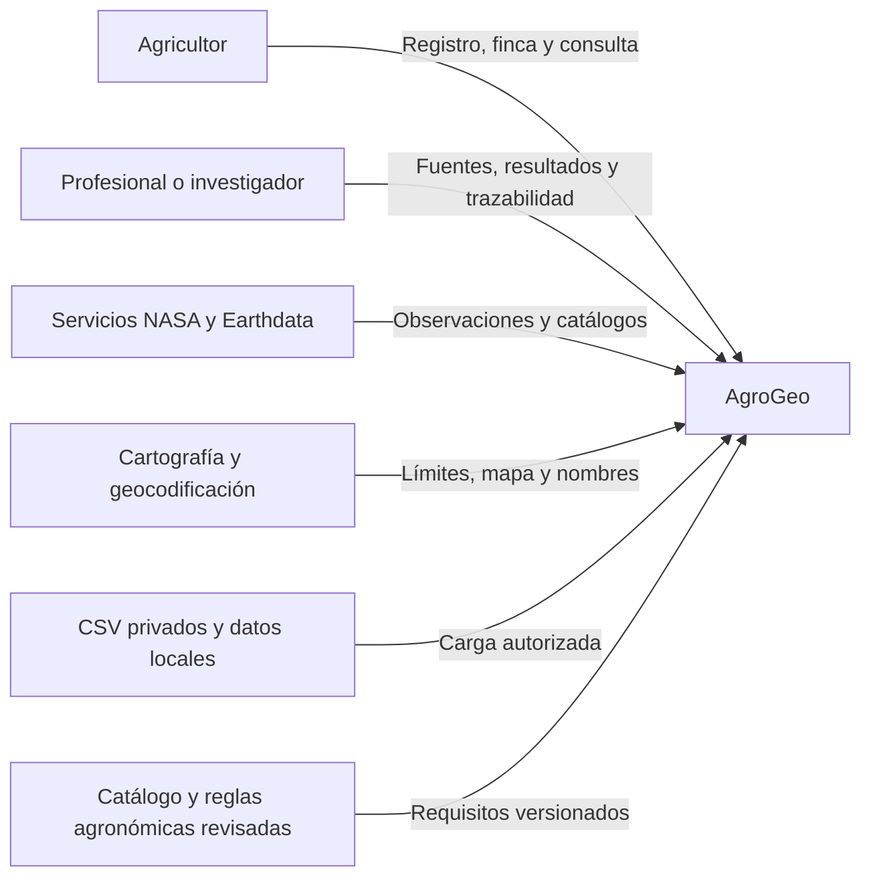
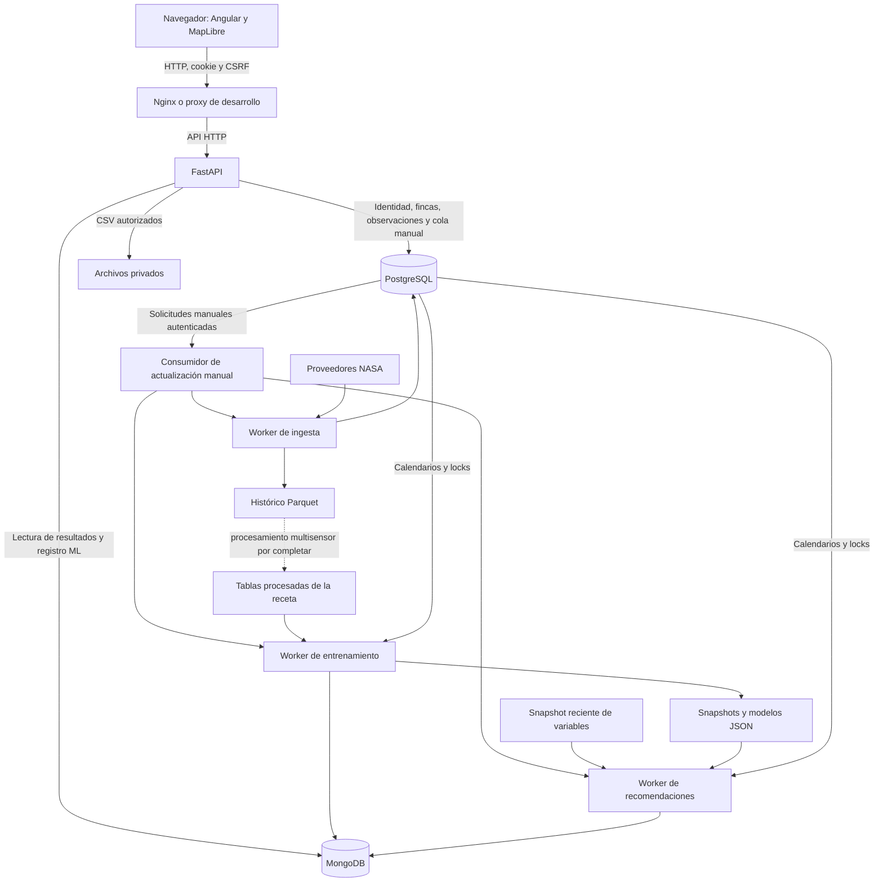

# Arquitectura del sistema

AgroGeo es un monorepo con aplicación Angular, API FastAPI y procesos Python
para ingesta, entrenamiento e inferencia. Los trabajos periódicos se ejecutan
fuera de las peticiones del usuario. Las responsabilidades se separan por módulos
y contratos; desplegar workers separados no convierte esos módulos en microservicios.

## Contexto — vista C4 de sistema

La API pública no devuelve archivos o mediciones privadas. Las cuentas de la
aplicación no conceden acceso a productos protegidos de Earthdata.

## Contenedores — vista C4 de ejecución

MongoDB es el backend de resultados predeterminado en Compose. El modo local
puede seleccionar PostgreSQL como alternativa explícita, con los mismos puertos
lógicos. No hay escritura doble ni fallback automático entre motores.

## Bloques y dependencias

| Bloque | Responsabilidad | Límite |
| --- | --- | --- |
| Ingesta | Obtener datos y conservar procedencia | No asigna etiquetas ni ejecuta modelos |
| Procesamiento | Limpiar, validar y construir variables | No inventa cobertura ni aumenta resolución |
| Entrenamiento | Capturar datasets, ajustar y evaluar candidatos | Publica solo con política y evidencia revisadas |
| Inferencia | Aplicar receta y modelo del horizonte | Exige snapshot espacial/temporal compatible |
| Rotación | Contrastar inferencias, catálogo y restricciones | Conserva desconocidos y evita aprobación incompleta |
| Persistencia | Guardar observaciones, identidades y resultados | Distingue histórico, datos privados y salidas ML |
| HTTP/web | Autorizar, consultar y representar | La consulta de análisis no ejecuta el pipeline |

`scripts/runtime.py` conecta implementaciones concretas y configuración.
`packages/contracts/` define DTOs y contratos compartidos. Los módulos ML no
requieren FastAPI para entrenar o inferir. Ubicación de clases y archivos en
[estructura del código](code-structure.md).

## Tiempo, espacio y publicación

Los jobs tienen calendarios y locks independientes. La ingesta diaria puede
actualizar datos sin producir suficientes etiquetas para entrenar o sin publicar
un candidato. Los horizontes tienen modelos separados; los targets agregan
`t+1..t+H` con entradas hasta `t-2`.

Una versión técnicamente apta permanece en revisión hasta satisfacer las barreras
científicas. La publicación agronómica requiere además reglas revisadas. La ficha
y los CSV de finca conservan su revisión y autorización; su uso en modelos no es
implícito. El ámbito del modelo y el polígono del lote se verifican por separado.

## Vistas complementarias

- [Flujos de ejecución](flows.md): escenarios de usuario y procesos periódicos.
- [Persistencia](persistence.md): colecciones, archivos, identidad y retención.
- [Despliegue](deployment.md): procesos, redes y directorios.
- [Personalización de finca](farm-personalization.md): uso de los datos del agricultor.
- [Decisión de límites y publicación](decisions/0001-runtime-boundaries.md).
- [Capacidades y restricciones](../reference/capabilities.md).
