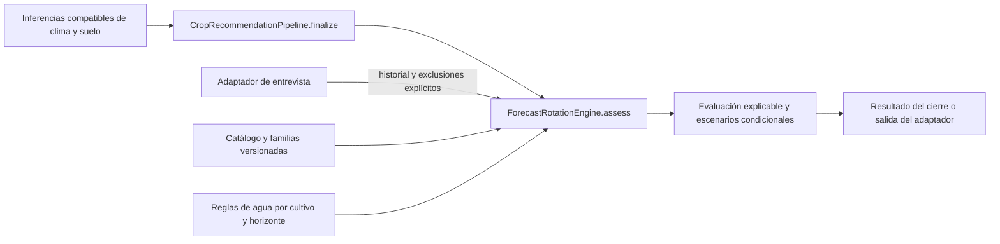

# Motor de evaluación de cultivos y rotación

## Responsabilidad e integración

`CropRecommendationPipeline.finalize` cierra el análisis después de inferir con
campeones o con el bundle experimental. Valida región, referencia, inicio y horizonte,
ejecuta `ForecastRotationEngine.assess` y persiste la evaluación con las inferencias.
El adaptador `modulo_rotacion/motor_rotacion.py` recibe historial y restricciones
y exige una asociación de región explícita.



El job regional llama al evaluador sin contexto privado. El adaptador de entrevista
admite historial y exclusiones explícitos. La conexión desde la ficha guardada de
una finca se define en [personalización](../architecture/farm-personalization.md).
La aprobación exige modelos y requisitos revisados. El alcance de las etapas de
ingesta, publicación y consulta está en [capacidades](capabilities.md).

## Significado de los resultados

`ForecastValue.statistic` separa mean de sum, además de unidades y texto de
agregación. `statistic` es obligatorio para interpretar las salidas; el motor no deduce
la semántica de textos libres.
El motor exige las cinco salidas, acepta únicamente unidades esperadas
y comprueba coherencia física básica. No interpreta una tasa como acumulado, ni
una media de mínimas como mínimo absoluto. Si falta una salida, pending_forecasts;
si corresponde a otra región o periodo o tiene semántica incompatible, se rechaza.

`rotation_assessment` contiene valores realmente predichos, versiones de ambos
modelos, catálogo, reglas y hash de entrada. La temperatura cambia los candidatos;
el historial evita repetir familia y las exclusiones del agricultor se respetan.
El job regional no lee entrevistas privadas. El adaptador de lote recibe ese
contexto explícitamente y no lo transfiere al análisis regional de otros usuarios.

Las comprobaciones de precipitación y humedad conservan sus valores aunque estén
unknown. Una regla revisada para un cultivo y horizonte permite compararlos con
límites explícitos; una regla de siete días no se extiende a treinta. No se obtiene
un requisito de días dividiendo el valor de mm/año del catálogo.

Las etapas posteriores de los escenarios solo expresan familias alternativas.
No tienen fechas meteorológicas ni evaluación de clima futuro. Se deben recalcular
con nuevas inferencias antes de decidir otra siembra. No se califican como las tres
mejores rotaciones: son escenarios condicionales de referencia y pueden ser menos
de tres o ninguno. No se utilizan supuestos de ingreso para prometer rentabilidad.

Las recomendaciones aprobadas siguen separadas en recommendations. El cierre no
llama al motor de publicación con modelos experimentales ni con evaluación de
rotación incompleta. El estado permanece pending_recommendations. Los fallos
tecnicos siguen el backoff del job; una falta de umbrales es un estado informativo.

## Verificación

Las pruebas usan predicciones fixture identificadas y también los veinte Boosters
reales. Comprueban sensibilidad a temperatura, lluvia y humedad; ausencia de
fallback de entrevista; identidad de región/periodo; unidades y estadísticas;
reglas revisadas por horizonte; restricciones y familias; etapas futuras no
evaluadas; persistencia del job; y bloqueo de publicación sin validación.

```bash
python -m scripts.verify_automation
npm test --prefix frontend -- --watch=false
npm run build --prefix frontend
```
