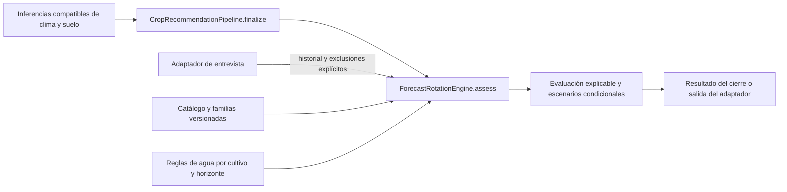

# Motor de evaluación de cultivos y rotación

## Responsabilidad e integración

`CropRecommendationPipeline.finalize` cierra el análisis después de inferir con
campeones o con el bundle experimental. Valida región, referencia, inicio y horizonte,
ejecuta `ForecastRotationEngine.assess` y persiste la evaluación con las inferencias.
El adaptador `modulo_rotacion/motor_rotacion.py` recibe historial y restricciones
y exige una asociación de región explícita.

`ml/recommendations/rotation_catalog.py` lee directamente
`modulo_rotacion/datos/cultivos.csv`. Sus 12 cultivos con especie identificada
delimitan las alternativas; descanso cubierto no se presenta como cultivo con
pronóstico evaluado. Cada fila se enlaza inequívocamente por especie y cadena
con su perfil ECOCROP. El CSV aporta identidad y familia; ECOCROP, los rangos
climáticos. Los parámetros marcados ESTIMADO no se convierten en umbrales de agua
ni en evidencia de rendimiento, ingreso o probabilidad de cosecha.

La evaluación conserva `crop_list_source`, `crop_list_sha256`,
`catalog_crop_id`, `temperature_fit` y límites térmicos óptimos. Clasifica la media
pronosticada en rango óptimo, tolerado o fuera de rango. Las alternativas en rango
óptimo aparecen primero, sin inventar puntuaciones dentro de ese grupo.
El hash del CSV participa en la identidad y las reglas del resultado. Cambiar
el catálogo requiere reiniciar el consumidor y recalcular las evaluaciones.



El job regional llama al evaluador sin contexto privado. El adaptador de entrevista
admite historial y exclusiones explícitos. La conexión desde la ficha guardada de
una finca se define en [personalización](../architecture/farm-personalization.md).
La aprobación exige modelos y requisitos revisados. El alcance de las etapas de
ingesta, publicación y consulta está en [capacidades](capabilities.md).

## Fuentes institucionales UPRA

La página de fuentes identifica dos conjuntos institucionales: EVA y calendarios
agrícolas de siembra/cosecha, y el consolidado de aptitud de cultivos de Antioquia.
Los archivos locales se encuentran en `data/Datos_locales/`: incluyen históricos
agrícolas, calendarios y `Aptitud_Cultivos_Antioquia_Consolidado.xlsx`.
Su presencia local no implica que formen parte de las variables XGBoost ni que
el worker ya consulte sus calendarios o aptitudes para recomendar.

El catálogo de rotación conserva la identidad `CADENA_UPRA` para asociar cultivos.
La integración de los consolidados requiere normalizar municipio, cultivo,
periodo y versión antes de combinarlos con las inferencias. Las estadísticas
territoriales y la aptitud se distinguen del pronóstico climático de la finca.

## Significado de los resultados

`ForecastValue.statistic` separa mean de sum, además de unidades y texto de
agregación. `statistic` es obligatorio para interpretar las salidas; el motor no deduce
la semántica de textos libres.
El motor exige las cinco salidas, acepta únicamente unidades esperadas
y comprueba coherencia física básica. No interpreta una tasa como acumulado, ni
una media de mínimas como mínimo absoluto. Si falta una salida, pending_forecasts;
si corresponde a otra región o periodo o tiene semántica incompatible, se rechaza.

`rotation_assessment` contiene valores realmente predichos, versiones de ambos
modelos, catálogo, reglas y hash de entrada. La temperatura cambia los candidatos;
el historial evita repetir familia y las exclusiones del agricultor se respetan.
El job regional no lee entrevistas privadas. El adaptador de lote recibe ese
contexto explícitamente y no lo transfiere al análisis regional de otros usuarios.

Las comprobaciones de precipitación y humedad conservan sus valores aunque estén
unknown. Una regla revisada para un cultivo y horizonte permite compararlos con
límites explícitos; una regla de siete días no se extiende a treinta. No se obtiene
un requisito de días dividiendo el valor de mm/año del catálogo.

Cada `RotationCheck` conserva `minimum` y `maximum` del intervalo realmente
comparado: límites absolutos ECOCROP para temperatura o límites de la regla de
agua revisada para ese horizonte. Sin regla de agua ambos campos son nulos.
Las vistas simple y técnica muestran lluvia acumulada y humedad superficial
previstas por cultivo, junto a su estado y rango disponible. «En rango» para
agua no significa «óptimo»: las reglas actuales solo definen límites aceptados.
«Sin umbral definido» conserva el valor predicho sin atribuirle aptitud.

Las etapas posteriores de los escenarios solo expresan familias alternativas.
No tienen fechas meteorológicas ni evaluación de clima futuro. Se deben recalcular
con nuevas inferencias antes de decidir otra siembra. No se califican como las tres
mejores rotaciones: son escenarios condicionales de referencia y pueden ser menos
de tres o ninguno. No se utilizan supuestos de ingreso para prometer rentabilidad.

Las recomendaciones aprobadas siguen separadas en recommendations. El cierre no
llama al motor de publicación con modelos experimentales ni con evaluación de
rotación incompleta. El estado permanece pending_recommendations. Los fallos
tecnicos siguen el backoff del job; una falta de umbrales es un estado informativo.

## Probabilidades

Los cinco modelos actuales realizan regresión de clima y humedad; no producen
probabilidades de éxito o aptitud por cultivo. La pertenencia a un rango térmico
y los MAE de validación no se convierten en porcentajes de éxito.

Cultivos y secuencias incluyen un `ProbabilityEstimate` con estado `unavailable`
y valor nulo por defecto. La interfaz muestra «No disponible». Un valor `calibrated` exige
probabilidad entre 0 y 1, evento definido, versión del modelo y de calibración.
La validación del contrato exige esa trazabilidad; no certifica por sí misma la
calidad científica de una futura estimación.

Para producir probabilidades se necesita definir el resultado a estimar,
recopilar etiquetas históricas por cultivo y validar y calibrar un estimador
independiente. Los archivos JSON de regresión no satisfacen esa dependencia.

## Verificación

Las pruebas usan predicciones fixture identificadas y también los cinco Boosters diarios
reales. Comprueban sensibilidad a temperatura, lluvia y humedad; ausencia de
fallback de entrevista; identidad de región/periodo; unidades y estadísticas;
reglas revisadas por horizonte; restricciones y familias; etapas futuras no
evaluadas; persistencia del job; y bloqueo de publicación sin validación.

```bash
python -m scripts.verify_automation
npm test --prefix frontend -- --watch=false
npm run build --prefix frontend
```
