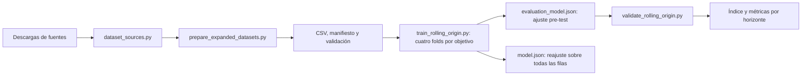

# Componentes ML y contratos de artefactos

El código de `ml/` sirve dos recorridos: reproducción de experimentos y ciclo
operativo de candidatos/publicación. Ambos conservan receta y fuentes; ejecutar
un script experimental no registra automáticamente un modelo operativo.

## Experimentación

`forecasts/{H}d/{modelo}/` contiene las cinco salidas para cada horizonte, incluida
la humedad residual. Las métricas de holdout pertenecen a `evaluation_model.json`;
el reajuste `model.json` no tiene evaluación independiente posterior. El índice
científico no sustituye el registro de campeones operativos.

Los archivos de humedad residual predicen un cambio. Sus adaptadores suman el
baseline observado exactamente una vez; cargarlos como regresión absoluta altera
el significado de la salida.

## Ciclo operativo

| Componente | Responsabilidad |
| --- | --- |
| ExpandedTrainingSnapshots | Congelar tablas procesadas, metadatos y hashes |
| ExpandedTrainingDatasetBuilder | Construir muestras multiespaciales con targets/fechas válidos |
| ExpandedXGBoostTrainer | Ajustar por target y guardar el Booster evaluado sin refit posterior |
| ModelTrainingPipeline | Separar fechas, comparar baseline/campeón y decidir publicación |
| ModelArtifactStore | Persistir versiones y comprobar integridad |
| RegisteredPredictorFactory | Cargar campeones con receta y snapshot compatible |
| ExpandedModelBundle | Cargar artefactos experimentales explícitamente provisionales |
| ForecastRotationEngine | Evaluar salidas, requisitos, familias y restricciones |

Los campeones usan los artefactos congelados que se evaluaron en el ciclo operativo.
No se confunden con los refits experimentales. El catálogo de referencia, la
comparación numérica y la evaluación de rotación conservan contratos diferentes
de una recomendación agronómica aprobada.

## Referencias principales

[Entrenamiento](../model-training.md), [inferencia](../model-inference.md),
[catálogo](../agronomic-catalog.md), [rotación](../crop-rotation.md) y
[estructura del repositorio](../../architecture/code-structure.md).
