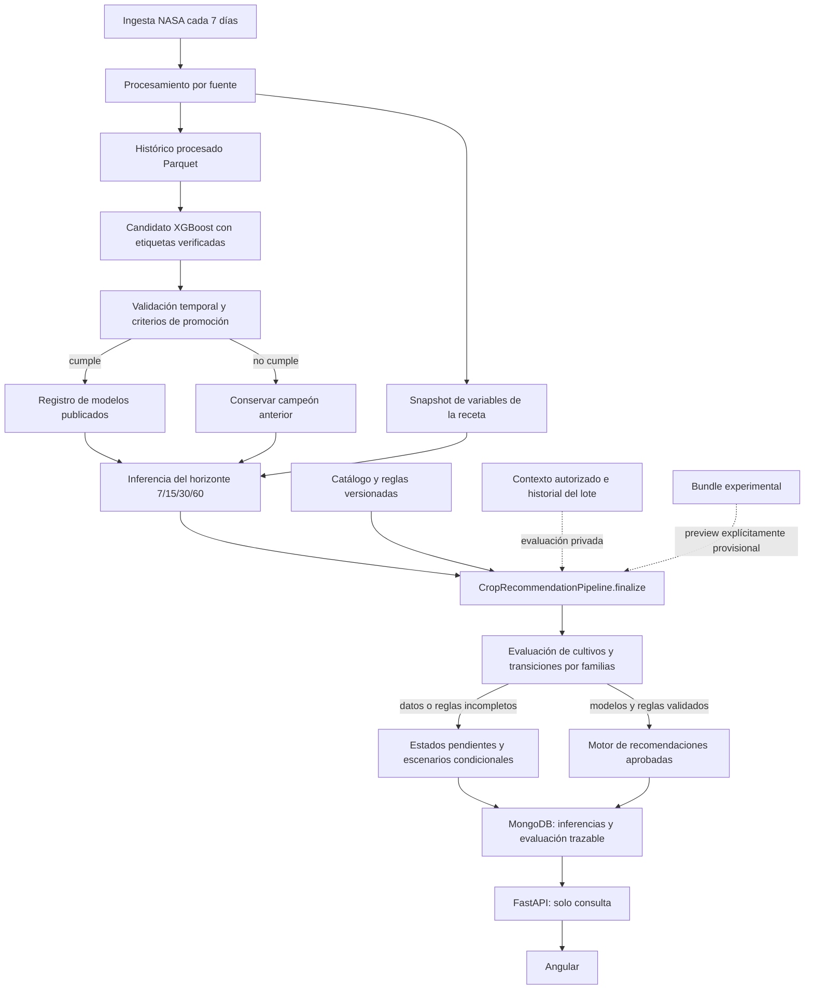

# Validación de arquitectura: inferencias y motor de rotación

## Hallazgos y corrección

El motor anterior ignoraba el módulo climático: transformaba la zona declarada
en 15, 21 o 26 °C, asignaba temporadas de lluvia supuestas y generaba cuatro bloques
trimestrales. El bundle XGBoost del job se guardaba directamente y nunca llamaba al
motor. Además, faltaban umbrales por cultivo para interpretar lluvia del horizonte
y humedad superficial. No era la arquitectura acordada.

Ahora se usa un único cierre de análisis, `CropRecommendationPipeline.finalize`,
después de inferir con campeones o con el bundle experimental. Ese cierre valida
la correspondencia de región, referencia, inicio y horizonte, ejecuta
`ForecastRotationEngine.assess` y guarda el resultado con las inferencias.
`modulo_rotacion/motor_rotacion.py` delega en el mismo motor y exige la asociación
de región del lote. Se retiraron sus constantes de clima y la simulación anual.



## Estado comprobado frente al diagrama del producto

| Etapa | Estado real |
| --- | --- |
| Ingesta | Scheduler semanal y reintentos durables. POWER obtiene observaciones; varios satélites siguen en descubrimiento, sin extracción completa. |
| Procesamiento e histórico | POWER/Parquet y scripts experimentales disponibles. Falta automatizar la extracción y construcción reciente completa de la receta multisensor. |
| Reentrenamiento | Pipeline y barreras implementados. build_jobs continúa sin builder, trainer y políticas científicas predeterminadas: informa pending_configuration. No hay aprendizaje autónomo completo activo. |
| Validación/publicación | Registro, artefactos y promoción condicional disponibles. Los veinte modelos recibidos siguen siendo experimentales, no campeones publicados. |
| Inferencia | Bundle de 7/15/30/60 conectado; consume snapshots exactos. Falta alimentar snapshots recientes para predicciones actuales. |
| Rotación | Conectada a las cinco salidas de XGBoost, catálogo y familias. Sin umbrales revisados de agua no aprueba siembra. |
| Persistencia | Se guarda rotation_assessment junto con las inferencias en MongoDB; PostgreSQL conserva el adapter de compatibilidad. |
| Consulta | FastAPI/Angular leen resultados guardados. No se consulta NASA, entrena o recomienda al abrir la página. El frontend actual es Angular. |

## Significado de los resultados

`ForecastValue.statistic` separa mean de sum, además de unidades y texto de
agregación. Los resultados anteriores sin statistic deben recalcularse con el
adapter actualizado; el motor no adivina esa semántica a partir de textos libres.
El motor exige las cinco salidas, acepta únicamente unidades esperadas
y comprueba coherencia física básica. No interpreta una tasa como acumulado, ni
una media de mínimas como mínimo absoluto. Si falta una salida, pending_forecasts;
si corresponde a otra región o periodo o tiene semántica incompatible, se rechaza.

`rotation_assessment` contiene valores realmente predichos, versiones de ambos
modelos, catálogo, reglas y hash de entrada. La temperatura cambia los candidatos;
el historial evita repetir familia y las exclusiones del agricultor se respetan.
El job regional no lee entrevistas privadas. El adaptador de lote recibe ese
contexto explícitamente y no lo transfiere al análisis regional de otros usuarios.

Las comprobaciones de precipitación y humedad conservan sus valores aunque estén
unknown. Una regla revisada para un cultivo y horizonte permite compararlos con
límites explícitos; una regla de siete días no se extiende a treinta. No se obtiene
un requisito de días dividiendo el valor de mm/año del catálogo.

Las etapas posteriores de los escenarios solo expresan familias alternativas.
No tienen fechas meteorológicas ni evaluación de clima futuro. Se deben recalcular
con nuevas inferencias antes de decidir otra siembra. No se califican como las tres
mejores rotaciones: son escenarios condicionales de referencia y pueden ser menos
de tres o ninguno. No se utilizan supuestos de ingreso para prometer rentabilidad.

Las recomendaciones aprobadas siguen separadas en recommendations. El cierre no
llama al motor de publicación con modelos experimentales ni con evaluación de
rotación incompleta. El estado permanece pending_recommendations. Los fallos
tecnicos siguen el backoff del job; una falta de umbrales es un estado informativo.

## Verificación

Las pruebas usan predicciones fixture identificadas y también los veinte Boosters
reales. Comprueban sensibilidad a temperatura, lluvia y humedad; ausencia de
fallback de entrevista; identidad de región/periodo; unidades y estadísticas;
reglas revisadas por horizonte; restricciones y familias; etapas futuras no
evaluadas; persistencia del job; y bloqueo de publicación sin validación.

```bash
python -m scripts.verify_automation
npm test --prefix frontend -- --watch=false
npm run build --prefix frontend
```
