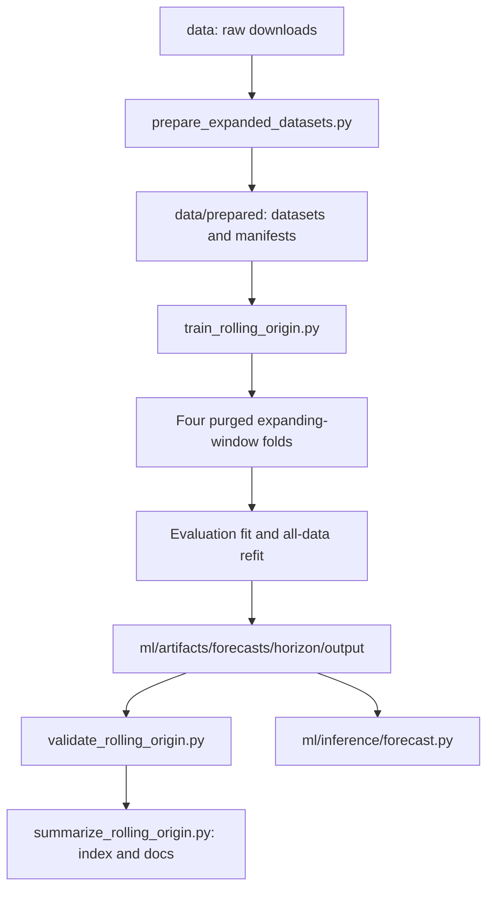

# ML folder architecture

The default pipeline prepares measurements, selects XGBoost configurations with rolling-origin validation, evaluates a chronological holdout and saves an all-data refit.

| Folder | Relationship and responsibility |
|---|---|
| ml/scripts | Preparation, rolling-origin training, validation and reporting |
| ml/configs | Canonical model names, horizons, artifact root and application crop catalogs |
| ml/artifacts/forecasts | Current models only; models.json indexes 20 output/horizon variants |
| ml/inference | ForecastPredictor loads by output and horizon and reconstructs moisture |
| ml/evaluation | Shared numerical metrics and application promotion checks |
| ml/training | Reusable application training adapters and lifecycle support |
| ml/docs | Dataset recipes, training protocol, inference, results and limitations |
| data/prepared | Model inputs and manifests consumed by training |

Each output folder contains `model.json` (all-data refit), `evaluation_model.json` (pre-test fit), metadata and validation predictions. Both models use rolling-origin-selected settings; only the evaluation fit has holdout scores. Output names are temperature_mean, temperature_min, temperature_max, precipitation and moisture.

The application registry and promotion lifecycle remain separate. Local training does not publish models to the API registry.

See [../README.md](../README.md) for commands, [rolling-origin-results.md](rolling-origin-results.md) for selection and [model-results.md](model-results.md) for scores.

## Previous iterations

Short complete-case datasets, single-split selection and an absolute-moisture comparator were used during development. Obsolete trained collections and training entry points have been removed. Current training derives partitions directly from prepared data and has no dependency on older artifacts.
