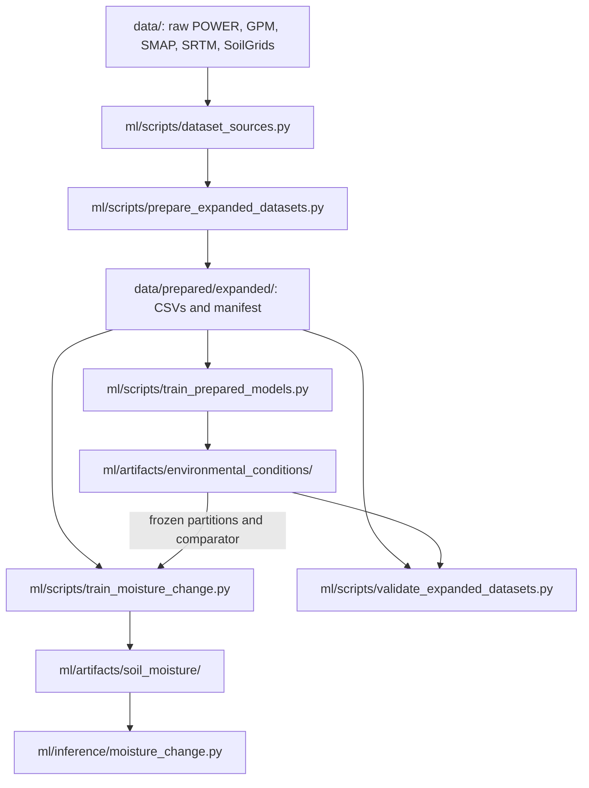
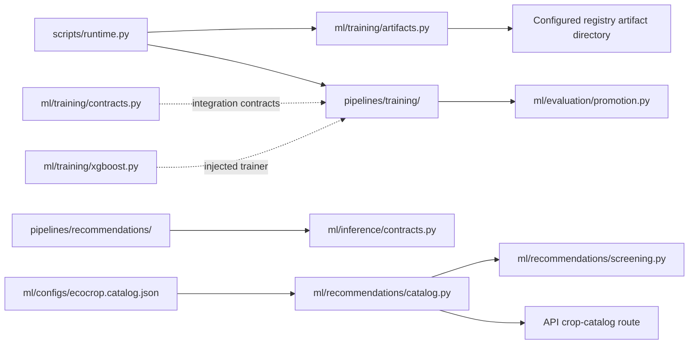

# How the ML folders relate

`ml/` contains the local model experiments and reusable application interfaces. They have different artifact contracts. Running an experiment does not register its models with the API or recommendation worker.

## Folder responsibilities

| Folder | Responsibility | Main consumers/dependencies |
|---|---|---|
| `scripts/` | Prepare expanded datasets, train experiments and validate results | Reads `data/`; writes `data/prepared/expanded/` and `artifacts/`; uses shared source extraction helpers and the moisture inference wrapper |
| `artifacts/` | Experiment models, feature schemas, source hashes, split records and evaluation outputs | Written by experiment training scripts; read by validation and experimental inference |
| `inference/` | Prediction interfaces and baseline-plus-change moisture inference | `contracts.py` is consumed by `pipelines/recommendations/`; `moisture_change.py` loads the moisture-change experiment artifacts |
| `training/` | Reusable trainer protocols, absolute-target XGBoost adapter and immutable artifact store | Used by the application runtime, lifecycle tests and `pipelines/training/` integration |
| `evaluation/` | Temporal splitting, MAE and promotion criteria | Consumed by `pipelines/training/pipeline.py` and lifecycle tests |
| `recommendations/` | Validated crop-catalog loading and numeric suitability screening | Used by API catalog routes, catalog tooling and tests; reads `configs/` |
| `configs/` | Versioned packaged crop catalog | Loaded by `recommendations/catalog.py`; generated by the repository crop-catalog command |
| `docs/` | Dataset recipes, inference instructions, evaluation results and limitations | Documentation for developers and model reviewers |

Package `__init__.py` files are retained so imports and packaged resources work consistently. Empty climate/soil placeholder folders and the empty `features/` folder were removed; current feature preparation lives in `scripts/prepare_expanded_datasets.py`.

## Experiment workflow

The shared source helper selects coverage-validated static collections, combines SMAP date selections and samples native raster/NetCDF cells. The preparation command builds finite, time-aligned features and targets. Training uses the manifest's ordered features and a chronological split with boundary purging.

`environmental_conditions/` holds the four climate regressors and the absolute-moisture comparator. That comparator remains necessary: moisture-change training verifies source identity, reuses its partitions and compares predictions on the same records. `soil_moisture/` holds the current baseline-plus-change moisture model. Its booster returns a change; `MoistureChangePredictor` adds the recent observed baseline to reconstruct absolute moisture.

Each `evaluation_model.json` has documented holdout results. A `model.json` refitted on all prepared rows has no independent post-refit test score. Feature lists and artifact meaning are recorded in the adjacent metadata. The plain absolute-regression loader must not load a moisture-change model as though its output were already absolute moisture.

## Application lifecycle and crop screening

The application lifecycle requires a dataset builder, trainer, validation policy, compatible interfaces and explicit registry publication. `training/artifacts.py` writes versioned JSON artifacts with hashes and verifies them before loading. `evaluation/promotion.py` compares candidates against baselines and incumbent models. Without the required injected components and policies, the pipeline reports pending configuration instead of publishing experiment files automatically.

The crop catalog and screening modules have API/tooling consumers independently of the forecast experiments. Their presence does not imply that the experimental forecasts already validate crop-rotation recommendations.

## Commands and documentation

Run module commands from the repository root; see `ml/README.md` for the complete sequence. Download tools remain in the repository `scripts/` folder. Raw and prepared data remain under `data/`.

- `expanded-datasets.md`: current feature/label recipes and data limitations.
- `model-results.md`: current climate/moisture scores and the Previous iterations history section.
- `moisture-change-model.md`: residual formula, saved-model contract and comparison results.

Generic lifecycle/catalog tests use synthetic fixtures to test software contracts. They are separate from empirical model evaluations and do not depend on the removed short-dataset experiment.
