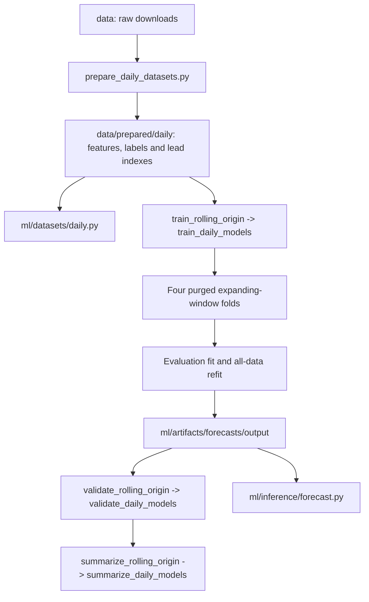

# ML folder architecture

The default workflow is source downloads -> daily preparation -> normalized datasets -> purged rolling-origin training -> output-named artifacts -> validation/reporting -> inference.

| Folder | Responsibility |
|---|---|
| data/prepared/daily | Current source features, daily labels, lead-pair indexes and label-free inference frames |
| ml/datasets | Bounded-batch joins; no synthetic target observations |
| ml/scripts | Preparation, fitting, validation and reporting |
| ml/artifacts/forecasts | Five current output-named model folders; index, pooled and per-lead metrics |
| ml/inference | Compatible ForecastPredictor API, lead/calendar handling and moisture reconstruction |
| ml/configs | Canonical names, all 60 leads, daily units and application crop catalogs |
| ml/training and ml/evaluation | Reusable application lifecycle and numerical evaluation support |
| ml/docs | Current pipeline, inputs, inference, verified scores and historical iterations |

Output names are temperature_mean, temperature_min, temperature_max, precipitation and moisture. Each serves leads 1-60. evaluation_model.json reproduces holdout scores; model.json is refitted on all pairs. Source hashes and fold partitions are recorded in training.json, test pairs in test_predictions.npz, and all-lead metrics in lead_metrics.csv.

Application registry/promotion modules are separate; local artifact replacement does not publish a model into the API registry.

## Previous iterations

Prepared aggregate datasets in expanded/ and horizons/ remain historical data. Their trained collections were replaced. The canonical training/validation/report command names are preserved, but now run the direct-daily implementations.
